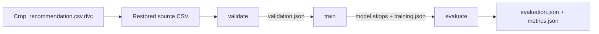
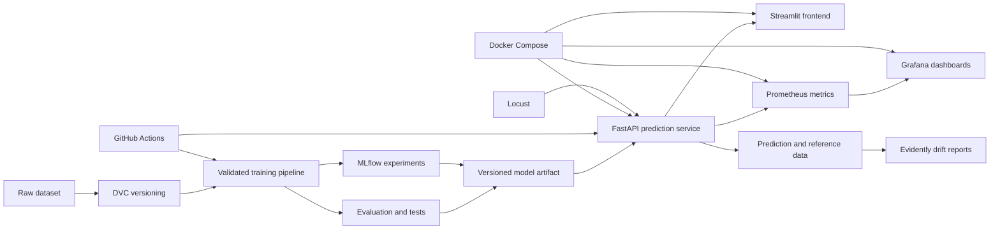

# Crop Recommendation — End-to-End MLOps

## Project Overview

This repository is the foundation for a production-oriented machine learning system that recommends a crop from soil nutrient measurements and environmental conditions. The prediction problem uses seven inputs—nitrogen, phosphorus, potassium, temperature, humidity, pH, and rainfall—to select one of 22 crop classes.

The project is being rebuilt incrementally from a small legacy prototype into a reproducible, testable, deployable, and observable MLOps portfolio project. Phase 1 provides the verified machine-learning foundation. Phase 2 adds local MLflow tracking, DVC data/pipeline versioning, and training-only controlled candidate comparison. Model promotion, serving, deployment, and monitoring remain future work.

> [!IMPORTANT]
> This is an educational decision-support project. A future prediction service should not be treated as agronomic advice without validation against representative local data and review by qualified domain experts.

## Project Objectives

The target project will demonstrate a complete machine learning lifecycle:

- reproducible data preparation, training, and evaluation;
- reliable multiclass evaluation with recorded artifacts and metrics;
- experiment tracking and data/model versioning;
- validated model serving through an API and user-facing application;
- automated tests, linting, and continuous integration and delivery;
- containerized local development and deployment;
- service, model, and data-quality monitoring; and
- drift detection and performance/load testing.

These are project objectives, not claims about the current implementation.

## Current Development Status

| Status | What exists |
| --- | --- |
| **Implemented in the new repository** | Phase 1: validated data, deterministic splitting, training-only fitting, held-out evaluation, and reproducibility. Phase 2, Steps 1–3: explicit MLflow baseline tracking, DVC-tracked data and pipeline state, and a fixed three-candidate Random Forest comparison using training-only stratified cross-validation. |
| **Legacy reference** | [`legacy/train_model.py`](legacy/train_model.py) contains a basic random-forest training script. [`legacy/app.py`](legacy/app.py) contains a Streamlit interface that loads a local pickle file. [`legacy/requirements.txt`](legacy/requirements.txt) lists their unpinned dependencies. These files have not been migrated into a production package. |
| **Planned** | Model registry and controlled promotion, FastAPI/Pydantic, a migrated Streamlit client, Docker, GitHub Actions, Prometheus, Grafana, Evidently, and Locust. None of these capabilities is currently implemented. |

MLflow model artifacts and tracking databases are generated locally under ignored `.mlflow/`. DVC-generated pipeline outputs are cached and ignored under `artifacts/dvc/`, while their identities are recorded in `dvc.lock`. No API, container configuration, CI workflow, monitoring stack, or deployment configuration is currently committed.

## Dataset Overview

The repository uses one canonical CSV path: `data/raw/Crop_recommendation.csv`. Git stores the small [`data/raw/Crop_recommendation.csv.dvc`](data/raw/Crop_recommendation.csv.dvc) pointer, while DVC restores the ignored CSV content at the path expected by the Python package.

| Property | Verified value |
| --- | --- |
| Records | 2,200 |
| Input features | 7 |
| Target column | `label` |
| Target classes | 22 |
| Missing values | 0 across all columns |
| Duplicate rows | 0 |
| Class balance | 100 records per class |

### Schema

| Column | Observed type | Observed range | Meaning |
| --- | --- | ---: | --- |
| `N` | Integer | 0–140 | Nitrogen measurement |
| `P` | Integer | 5–145 | Phosphorus measurement |
| `K` | Integer | 5–205 | Potassium measurement |
| `temperature` | Numeric | 8.8257–43.6755 | Temperature; the legacy UI labels this as °C |
| `humidity` | Numeric | 14.2580–99.9819 | Relative humidity; the legacy UI labels this as percent |
| `ph` | Numeric | 3.5048–9.9351 | Soil pH |
| `rainfall` | Numeric | 20.2113–298.5601 | Rainfall; the legacy UI labels this as millimetres |
| `label` | String | 22 classes | Crop to recommend |

The CSV does not include a data dictionary, provenance, collection dates, geographic coverage, or units metadata. Units above are only stated where the legacy interface supplies them; the nutrient units remain undocumented.

### Target-Class Distribution

The dataset is exactly balanced. Each of these classes has 100 records:

`apple`, `banana`, `blackgram`, `chickpea`, `coconut`, `coffee`, `cotton`, `grapes`, `jute`, `kidneybeans`, `lentil`, `maize`, `mango`, `mothbeans`, `mungbean`, `muskmelon`, `orange`, `papaya`, `pigeonpeas`, `pomegranate`, `rice`, and `watermelon`.

## Current Repository Structure

Generated files, caches, virtual environments, and `.git/` are omitted.

```text
Crop-Recommendation-MLOps/
├── .dvc/
├── .dvcignore
├── .gitignore
├── .python-version
├── data/
│   └── raw/
│       └── Crop_recommendation.csv.dvc
├── docs/
│   ├── phase1-verification.md
│   ├── phase2-step1-verification.md
│   ├── phase2-step2-verification.md
│   └── phase2-step3-verification.md
├── legacy/
│   ├── app.py
│   ├── requirements.txt
│   └── train_model.py
├── src/
│   └── crop_recommendation/
│       ├── __init__.py
│       ├── data/
│       │   ├── __init__.py
│       │   ├── preprocessing.py
│       │   └── validation.py
│       ├── experiments/
│       │   ├── __init__.py
│       │   ├── command.py
│       │   ├── comparison.py
│       │   └── tracking.py
│       ├── tracking/
│       │   ├── __init__.py
│       │   ├── command.py
│       │   ├── mlflow_tracking.py
│       │   └── server.py
│       ├── pipeline/
│       │   ├── __init__.py
│       │   └── dvc_pipeline.py
│       └── training/
│           ├── __init__.py
│           ├── evaluate.py
│           ├── evaluate_command.py
│           └── train.py
├── tests/
│   ├── test_data.py
│   ├── test_end_to_end.py
│   ├── test_evaluation.py
│   ├── test_experiment_comparison.py
│   ├── test_dvc_pipeline.py
│   ├── test_mlflow_tracking.py
│   ├── test_preprocessing.py
│   └── test_training.py
├── dvc.lock
├── dvc.yaml
├── params.yaml
├── pyproject.toml
├── README.md
└── uv.lock
```

## Current Implementation

The new implementation provides data validation, reproducible splitting, training-only Random Forest fitting, prediction-only held-out evaluation, an end-to-end Phase 1 release gate, local MLflow tracking, DVC data/pipeline versioning, and controlled training-only candidate comparison. The previous training and inference workflow remains under `legacy/` as migration reference.

### Data validation

[`src/crop_recommendation/data/validation.py`](src/crop_recommendation/data/validation.py) defines the dataset contract, validates CSV files without modifying them, and returns a typed report containing schema, missing/infinite values, duplicates, invalid rows, class distribution, numeric summaries, errors, and warnings. It enforces the seven-feature order and the verified 22-label vocabulary.

The `validate-crop-data` command uses a dataset path derived from the module location, so its default does not depend on the caller's working directory. Invalid data produces a nonzero exit status. [`tests/test_data.py`](tests/test_data.py) covers valid data, schema failures, malformed values, physical domain rules, duplicates, label rules, reporting, CLI behavior, the real CSV, and working-directory independence.

### Data preparation and splitting

[`src/crop_recommendation/data/preprocessing.py`](src/crop_recommendation/data/preprocessing.py) refuses invalid data, extracts the seven named features in contract order, separates `label`, and uses Scikit-learn's `train_test_split` with `test_size=0.2`, `random_state=42`, and `stratify=y`. The configuration is explicit and validated, and impossible stratification fails without falling back to an unstratified split.

`DataSplit` retains Pandas DataFrames/Series, source-row indices, configuration, partition sizes, and per-partition class distributions. The real dataset produces 1,760 training rows and 440 test rows, with 80/20 records per crop. No transformations are fitted in this step. Future preprocessing must be fitted on training data only, preferably inside a Scikit-learn `Pipeline`, then applied to held-out data.

Reproducibility depends on the input data identity, split configuration, and relevant software versions. The same inputs and seed are tested to reproduce the same partitions, but cross-version bit-for-bit identity is not promised.

### Model training

[`src/crop_recommendation/training/train.py`](src/crop_recommendation/training/train.py) defines a validated `TrainingConfig`, a classifier-only Scikit-learn `Pipeline`, and `train_model(X_train, y_train, config)`. The baseline uses `RandomForestClassifier(n_estimators=100, random_state=42)` and otherwise retains Scikit-learn defaults. The core function accepts no test data, copies its inputs before fitting, verifies feature names/order and target alignment, and returns a fresh fitted estimator with serializable `TrainingMetadata`.

The current pipeline intentionally has no scaling, encoding, or imputation because the validated inputs are seven finite numeric features and Random Forest does not require scaling. A pipeline still provides the safe extension point for future fitted preprocessing, which must be learned from training data only. Repeated training with identical data, configuration, seed, and locked environment is tested to produce identical predictions on a fixed probe; byte-for-byte artifact identity is not claimed.

The training component is separate from evaluation. The held-out 440 rows are not accepted by the training API, and training itself computes no accuracy, precision, recall, F1, confusion matrix, or other performance result. Training does not serialize models; the separate tracking layer manages the fitted artifact after evaluation.

### Model evaluation

[`src/crop_recommendation/training/evaluate.py`](src/crop_recommendation/training/evaluate.py) accepts an already fitted estimator plus `X_test` and `y_test`. It validates the feature and target contract, verifies fitted feature/class metadata, calls only `predict`, and returns JSON-compatible `EvaluationResult` data. The result includes accuracy, macro precision, macro recall, macro F1, a stable 22×22 confusion matrix, per-class precision/recall/F1/support, metadata, and explicit `zero_division=0` warnings when a class has no actual or predicted samples.

[`src/crop_recommendation/training/evaluate_command.py`](src/crop_recommendation/training/evaluate_command.py) is the orchestration layer: it fingerprints the dataset, creates the fixed split, trains only on the training partition, and evaluates only on the held-out partition. The core evaluation function never calls `fit`, and neither module serializes a model.

Measured with the locked dataset and baseline configuration:

| Metric | Measured value |
| --- | ---: |
| Accuracy | 0.995454545455 |
| Macro precision | 0.995670995671 |
| Macro recall | 0.995454545455 |
| Macro F1 | 0.995451702769 |

The 440-row confusion matrix contains 438 correct predictions. One `blackgram` row was predicted as `maize`, and one `rice` row was predicted as `jute`; all other held-out rows were classified correctly. These measurements describe this fixed dataset and split only and are not evidence of real-world agricultural suitability.

### Phase 1 verification

[`tests/test_end_to_end.py`](tests/test_end_to_end.py) runs the complete real-data workflow twice and requires identical partitions, metadata, predictions, metrics, and confusion matrices. It independently recomputes every headline metric and the confusion matrix from the fixed predictions, verifies row conservation and train/test disjointness, and checks cross-component metadata consistency. The commands, environment, dataset fingerprint, results, and remaining limitations are recorded in [`docs/phase1-verification.md`](docs/phase1-verification.md).

### MLflow experiment tracking

[`src/crop_recommendation/tracking/mlflow_tracking.py`](src/crop_recommendation/tracking/mlflow_tracking.py) records the established fitted pipeline and evaluation without changing or refitting them. It rejects non-baseline split/model configurations and verifies that the fingerprinted CSV exactly reconstructs the supplied partitions. The integration logs real estimator parameters, held-out metrics, dataset/software/Git metadata, a complete JSON evaluation report, and an MLflow Scikit-learn model with a training-derived input example and seven-column signature. The stored model is loaded immediately and must reproduce the example predictions before the run succeeds.

An **experiment** is a named collection of related runs; this project uses `crop-recommendation-baseline`. A **run** is one execution of the fixed workflow, with its own ID and recorded values. Repeated integration runs verify plumbing, but they are not independent validation or model selection.

| MLflow record | Meaning in this project |
| --- | --- |
| Parameter | An input or configuration such as `n_estimators=100`, seeds, split size, or an explicit estimator setting. |
| Metric | A numeric measured result such as accuracy, macro F1, or test sample count. |
| Tag | Searchable context such as dataset SHA-256, feature order, library versions, Git revision, and `evaluation_protocol=fixed_holdout`. |
| Artifact | A larger file or model, including the JSON report and trusted fitted Scikit-learn pipeline. |

The default tracking URI is the absolute repository-local SQLite database `.mlflow/mlflow.db`. SQLite is the **backend store** for experiment/run metadata, parameters, metrics, and tags. `.mlflow/artifacts/` is the separate **artifact store** for reports and serialized models. [`src/crop_recommendation/tracking/server.py`](src/crop_recommendation/tracking/server.py) starts the UI and REST server on `127.0.0.1` against those same persistent stores. The server is optional while logging directly to SQLite, but is required to browse the UI.

The model signature names the seven input columns and their types/order so MLflow can describe and enforce the inference contract. Its input example contains only deterministic rows from the training partition, never held-out test features. MLflow 3.17 uses a security-aware serializer; the integration trusts only Random Forest's specific `sklearn.tree._tree.Tree` type. Serialized models must still be treated as trusted artifacts and never loaded from an untrusted source.

Phase 2, Step 1 does not perform hyperparameter comparison, model registration, or promotion. Its verification evidence is recorded in [`docs/phase2-step1-verification.md`](docs/phase2-step1-verification.md); DVC is implemented separately in Step 2 below.

### DVC data and pipeline versioning

Phase 2, Step 2 uses DVC 3.67.1 to version the original CSV content and orchestrate the existing Phase 1 APIs. Git owns source code, `dvc.yaml`, `params.yaml`, `dvc.lock`, and the `.dvc` pointer; DVC owns the large data and generated pipeline outputs; MLflow owns explicit experiment runs, searchable metrics, signatures, and logged models. Running the DVC pipeline never creates an MLflow run.



[`dvc.yaml`](dvc.yaml) declares the real stage commands, code/data dependencies, parameter keys, and outputs. [`params.yaml`](params.yaml) is the pipeline's single configuration source and preserves the fixed 80/20 split and 100-tree Random Forest with seed 42. DVC generates [`dvc.lock`](dvc.lock) from actual dependency and output hashes; do not edit those hashes manually. `uv.lock` answers a different question: it locks the Python dependency environment, whereas `dvc.lock` locks the state of the data pipeline.

The workspace contains checked-out files. `.dvc/cache/` is the local content-addressed cache used to materialize them. The ignored `.dvc-remote/` directory is a separate project-local storage remote populated by `dvc push`. Machine-specific remote configuration lives in ignored `.dvc/config.local`; after cloning, configure it with:

```bash
uv run dvc remote add --local -d local-storage .dvc-remote
```

This remote is useful for learning and local recovery, but it does not share data across machines. A team would configure shared object storage separately and keep credentials outside tracked files.

The train stage writes `artifacts/dvc/model.skops`, a pipeline-only intermediate loaded with an exact trusted-type allowlist and verified seven-feature schema. It is not the MLflow logged model, a registry candidate, or a production promotion. Never load arbitrary serialized models, including pickle/joblib files or untrusted Skops files. The DVC report records the CSV's DVC MD5 and SHA-256; a future explicit MLflow run can record either content identity or a committed Git/DVC revision to connect experiment lineage to data lineage.

Verification evidence is recorded in [`docs/phase2-step2-verification.md`](docs/phase2-step2-verification.md). Controlled comparison is implemented separately in Step 3 below.

### Controlled experiment comparison

Phase 2, Step 3 compares three predetermined Random Forest configurations using only the established 1,760-row training partition. [`src/crop_recommendation/experiments/comparison.py`](src/crop_recommendation/experiments/comparison.py) constructs `StratifiedKFold(n_splits=5, shuffle=True, random_state=42)`. Each candidate therefore fits five fresh models: every fold trains on 1,408 rows and validates on 352 rows, with 64/16 examples per crop. The outer 440-row test partition is not accepted by the comparison API and is not used for fitting, ranking, or tie-breaking.

| Candidate | Trees | Mean CV macro F1 | Population std. dev. |
| --- | ---: | ---: | ---: |
| RF-50 | 50 | 0.993090043022 | 0.008703115771 |
| RF-100 | 100 | 0.993703346086 | 0.006139964810 |
| RF-200 | 200 | 0.994292488744 | 0.004782482694 |

The selection policy was fixed before execution: rank by highest mean macro F1; when means differ by no more than `1e-12`, prefer fewer trees. RF-200 has the best observed mean and is the current recommendation. This small difference does not prove statistical superiority, and recommendation is not registry approval or production promotion.

Each candidate is logged as one result-only run in the separate MLflow experiment `crop-recommendation-cv`. Runs include all fold scores, aggregate means and population standard deviations, candidate/CV parameters, source SHA-256, DVC MD5, training-partition fingerprint, software/Git metadata, and explicit `outer_holdout_used=false`. No model artifact or registry version is created. The stable local report is written beneath ignored `.mlflow/comparisons/`.

Run the fixed comparison with:

```bash
uv run compare-crop-models
uv run compare-crop-models --json
```

Open `uv run serve-crop-mlflow`, select `crop-recommendation-cv`, and compare `mean_cv_macro_f1`, `std_cv_macro_f1`, and the fold metrics. DVC supplies the source content identity but remains decoupled from side-effecting MLflow runs. `params.yaml`, `dvc.yaml`, and baseline metrics remain unchanged. Registering the CLI changed the declared `pyproject.toml` dependency, so DVC legitimately refreshed dependency/output hashes in `dvc.lock`; no candidate result was added to the DVC pipeline. Detailed evidence is in [`docs/phase2-step3-verification.md`](docs/phase2-step3-verification.md).

### Legacy training reference

[`legacy/train_model.py`](legacy/train_model.py):

1. Reads `Crop_recommendation.csv` from the process's current working directory.
2. Uses all columns except `label` as features and `label` as the target.
3. Creates an 80/20 train/test split with `random_state=42`.
4. Trains `sklearn.ensemble.RandomForestClassifier` with 100 trees and `random_state=42`.
5. Serializes the fitted estimator to `model.pkl` in the current working directory.

The script creates a test split but never uses it for evaluation. It does not stratify explicitly, validate the schema, record parameters or environment details, persist metrics, or package preprocessing with the model.

### Inference

[`legacy/app.py`](legacy/app.py) starts a Streamlit form with one numeric field for each of the seven features. On submission, it constructs a NumPy row in the training column order, calls `model.predict`, and displays the predicted class.

The application expects `model.pkl` in the process's current working directory. There is no API, input schema, realistic range validation, error handling, probability/confidence output, model metadata, or production deployment configuration. Because both scripts rely on relative working-directory paths, they are fragile when launched from another directory.

### Dependencies

The new package targets Python 3.12. `pyproject.toml` declares MLflow 3.17, DVC 3.67, Pandas 2.x, PyYAML 6.x, Skops 0.16, Scikit-learn 1.5–1.7, and pytest; `uv.lock` currently resolves DVC 3.67.1, MLflow 3.17.2, and Scikit-learn 1.7.2. [`legacy/requirements.txt`](legacy/requirements.txt) separately lists unpinned `streamlit`, `pandas`, `scikit-learn`, and `numpy` dependencies for the legacy workflow. The legacy training script also uses Python's standard-library `pickle` module.

## Planned Architecture

### Target architecture



The intended lifecycle is: version the data, validate inputs, train reproducibly, compare experiments, approve a model artifact, serve it behind a validated API, consume it from a lightweight frontend, and observe both operational behavior and data drift. CI/CD and containers will make those steps repeatable.

## Technology Stack

| Area | Current repository | Planned use |
| --- | --- | --- |
| Language and data | Python 3.12, Pandas, `src/` package | Deterministic ML pipelines |
| Machine learning | Scikit-learn split, Random Forest training, held-out metrics, and fixed training-only CV comparison | Registry approval and promoted artifact persistence |
| Testing and quality | pytest validation, splitting, training, evaluation, reproducibility, and MLflow tracking suites | Ruff, pre-commit, and serving/operational tests |
| Experiment tracking | MLflow 3.17.2 with local SQLite metadata and filesystem artifacts | Remote/team storage and later promotion policy |
| Data/model versioning | DVC 3.67.1 pointer, cache, local remote, and three-stage pipeline | Shared remote storage and committed lineage |
| Prediction service | Not implemented | FastAPI and Pydantic |
| User interface | Legacy Streamlit script | Streamlit client integrated with the API |
| Containers | Not implemented | Docker and Docker Compose |
| CI/CD | Not implemented | GitHub Actions |
| Metrics and dashboards | Not implemented | Prometheus and Grafana |
| Data/model monitoring | Not implemented | Evidently |
| Load testing | Not implemented | Locust |

## Development Roadmap

**Phase 1 is complete.** Steps 1–5 implement and verify validation, deterministic splitting, training-only baseline fitting, held-out evaluation, and end-to-end reproducibility in the locked environment.

### Phase 1: ML Foundation and Reliable Evaluation

- Create a maintainable Python package and locked environment.
- Add deterministic data loading, schema validation, and stratified splitting.
- Fit the configured Random Forest baseline on training data only.
- Report accuracy, macro precision, macro recall, macro F1, per-class metrics, and a stable confusion matrix on the held-out partition.
- Record reproducibility metadata and verify two independent end-to-end runs.
- Add focused unit and integration tests for Phase 1 boundaries and likely failure paths.

Model selection, artifact persistence, tracking, and serving are deliberately deferred; Phase 1 does not claim those capabilities.

### Phase 2: Experiment Tracking, Versioning and Reproducibility

- **Step 1 complete:** track the fixed baseline's parameters, metrics, tags, report, signature, and fitted pipeline with MLflow.
- **Step 2 complete:** version the source dataset and validate → train → evaluate dependencies and outputs with DVC.
- **Step 3 complete:** compare RF-50, RF-100, and RF-200 with deterministic training-only stratified cross-validation and log one MLflow run per candidate.
- **Step 4 next:** define model-registry lineage, approval criteria, aliases, and controlled promotion.
- Maintain dependency and environment lineage as the project evolves.
- Define model promotion and artifact lineage conventions.

Phase 2 is not complete. Model registry and controlled promotion are the next step.

### Phase 3: Prediction API and Frontend Integration

- Expose health, metadata, and prediction endpoints with FastAPI.
- Validate requests and responses with Pydantic.
- Migrate the Streamlit interface to consume the API instead of loading pickle directly.
- Add API and end-to-end contract tests.

### Phase 4: Docker, Code Quality and CI/CD

- Add Ruff, pre-commit, and enforced pytest checks.
- Containerize the API and frontend and orchestrate them with Docker Compose.
- Add GitHub Actions workflows for quality, tests, builds, and controlled releases.
- Document local and CI environment parity.

### Phase 5: Monitoring, Observability and Drift Detection

- Instrument request, latency, error, and prediction metrics for Prometheus.
- Build Grafana dashboards and actionable alerts.
- Generate Evidently data-quality and drift reports against a defined reference set.
- Define logging, retention, and retraining triggers without collecting unnecessary sensitive data.

### Phase 6: Performance Testing, Final Validation and Portfolio Release

- Exercise API behavior under representative load with Locust.
- Validate failure modes, documentation, reproducibility, and container startup.
- Record final model and service results with their test conditions.
- Prepare a transparent portfolio release with architecture and operational evidence.

## Getting Started

The current workflow covers validation, splitting, baseline training, held-out evaluation, and local experiment tracking. Deployment remains future work, and the old prototype remains legacy reference code. The commands below are for Git Bash and should be run from the repository root. The Python commands resolve dataset and MLflow storage defaults from the installed module rather than constructing paths from the caller's working directory.

### 1. Create the locked Python 3.12 environment

```bash
uv sync
```

`uv` reads `.python-version`, creates `.venv`, and installs the locked runtime and development dependencies.

### 2. Reproduce and inspect the DVC pipeline

After a fresh clone, configure an appropriate DVC remote and restore the CSV. For this local learning setup:

```bash
uv run dvc remote add --local -d local-storage .dvc-remote
uv run dvc pull data/raw/Crop_recommendation.csv.dvc
uv run dvc dag
uv run dvc status
uv run dvc repro
uv run dvc metrics show
```

`dvc repro` executes `validate`, `train`, and `evaluate` only when their declared data, code, parameter, or upstream-output state changed. A repeated unchanged run reports each stage as skipped and leaves `dvc status` up to date. To back up all current data and pipeline outputs to the configured remote, run `uv run dvc push`.

### 3. Validate the real dataset

```bash
uv run validate-crop-data
```

The command prints a JSON report and exits with status `0` when the contract passes or a nonzero status when it fails. An explicit CSV can be supplied with `uv run validate-crop-data path/to/data.csv`.

### 4. Run the test suite

```bash
uv run python -m pytest -p no:cacheprovider --basetemp=.test-tmp/full
```

To run focused component, end-to-end, or real-dataset integration checks:

```bash
uv run python -m pytest tests/test_preprocessing.py -p no:cacheprovider --basetemp=.test-tmp/preprocessing
uv run python -m pytest tests/test_training.py -p no:cacheprovider --basetemp=.test-tmp/training
uv run python -m pytest tests/test_evaluation.py -p no:cacheprovider --basetemp=.test-tmp/evaluation
uv run python -m pytest tests/test_end_to_end.py -p no:cacheprovider --basetemp=.test-tmp/end-to-end
uv run python -m pytest tests/test_mlflow_tracking.py -p no:cacheprovider --basetemp=.test-tmp/mlflow
uv run python -m pytest tests/test_dvc_pipeline.py -p no:cacheprovider --basetemp=.test-tmp/dvc
uv run python -m pytest tests/test_experiment_comparison.py -p no:cacheprovider --basetemp=.test-tmp/comparison
uv run python -m pytest -m integration -p no:cacheprovider --basetemp=.test-tmp/integration
```

### 5. Run the fixed baseline evaluation

```bash
uv run python -m crop_recommendation.training.evaluate_command
```

The command prints the dataset fingerprint, split/training metadata, measured metrics, complete per-class report, and numeric confusion matrix. For a machine-readable report:

```bash
uv run python -m crop_recommendation.training.evaluate_command --json
```

### 6. Compare the controlled candidates

```bash
uv run compare-crop-models
```

Use `--json` for the complete machine-readable report and MLflow run identities. The command performs 15 total fits—five folds for each of three candidates—using only the original training partition. It does not evaluate or refit on the outer test partition.

### 7. Record the fixed baseline in MLflow

The tracking server does not need to be running for this local SQLite workflow:

```bash
uv run track-crop-baseline
```

Use `uv run track-crop-baseline --json` for machine-readable experiment, run, model, fingerprint, and metric output. Each invocation records the same established configuration as a new run; it does not tune or compare models.

### 8. Open the local MLflow interface

```bash
uv run serve-crop-mlflow
```

Open <http://127.0.0.1:5000>, select `crop-recommendation-baseline`, then inspect the run's parameters, metrics, tags, JSON report, model signature, and input example. Stop the server with `Ctrl+C`. The command binds only to localhost, upgrades the persistent SQLite schema when necessary, and uses the same `.mlflow/` backend and artifact paths as the logging command.

Local `.mlflow/` state is ignored by Git and persists across server restarts. Back it up before an MLflow upgrade if the records matter. This setup has no authentication or multi-user concurrency guarantees and is not a production tracking deployment.

### 9. Run the legacy prototype (optional)

The legacy dependencies are separate and unpinned. Install them only if you want to inspect the pre-migration application:

```bash
uv pip install -r legacy/requirements.txt
```

The legacy scripts resolve the dataset and model relative to the current working directory. Run them from `data/raw`:

```bash
cd data/raw
python ../../legacy/train_model.py
streamlit run ../../legacy/app.py
```

Training creates an ignored `data/raw/model.pkl`. Only load pickle artifacts that you trust. FastAPI, Docker Compose, and monitoring commands will be documented only after those components exist.

## Evaluation Strategy

The baseline evaluation reports:

- **accuracy** for overall multiclass correctness;
- **macro precision**, **macro recall**, and **macro F1** so every fitted crop class contributes equally;
- a stable **confusion matrix** whose rows are actual crops and columns are predictions;
- per-class precision, recall, F1, and support; and
- dataset, split, model, and software metadata needed to reproduce the run.

Training, model selection, and final evaluation are distinct activities. This report measures the fixed baseline once on the held-out set; it must not become a hyperparameter-tuning signal. Future configuration comparisons should use cross-validation inside the training partition. If model choices are repeatedly influenced by this test report, a new independent final evaluation set may be required to restore an unbiased assessment.

## Future Improvements

- Establish data provenance, licensing, units, geography, and collection methodology.
- Add data contracts, range checks, semantic validation, and out-of-distribution handling.
- Compare a simple baseline with candidate classifiers using a consistent evaluation protocol.
- Make feature order and preprocessing part of one serialized inference pipeline.
- Replace direct pickle loading in the UI with a versioned, validated API contract.
- Add model metadata, calibrated probabilities where appropriate, and transparent limitations.
- Introduce experiment lineage, artifact checksums, model promotion criteria, and rollback procedures.
- Monitor data quality and drift, then define human-reviewed retraining policies.
- Evaluate the system on representative external or newly collected data before any real-world use.

## Contributing / Development Notes

Development will proceed one roadmap phase at a time. Each change should:

1. state its scope and acceptance criteria;
2. include or update tests and documentation;
3. keep generated artifacts out of source control unless deliberately versioned;
4. record reproducibility assumptions and evidence;
5. pass automated quality checks introduced by the active phase; and
6. avoid describing planned capabilities as completed work.

The `legacy/` directory is reference material. New production code should not silently modify its behavior; migration decisions should be explicit and reviewable.

## Known Limitations

- The migrated package tracks one fixed baseline and recommends one candidate from a narrow predefined comparison; there is no registry promotion policy, serving pipeline, or external artifact store.
- The legacy script's test split remains unused; verified metrics come from the separate migrated package.
- The validation contract checks physical bounds only where justified; nutrient, temperature, and rainfall operating ranges remain unspecified.
- Dataset provenance, license, units for nutrient values, geography, time period, and sampling method are not documented in the repository.
- Perfect class balance may reflect dataset construction rather than real-world crop prevalence.
- The available data cannot establish generalization across regions, seasons, sensors, or changing climate conditions.
- New package dependencies are locked for Python 3.12, but legacy application dependencies remain unpinned.
- Pickle artifacts are environment-sensitive and unsafe to load from untrusted sources.
- Local MLflow uses SQLite and filesystem artifacts without authentication, backup automation, or multi-user concurrency guarantees.
- MLflow job execution is unsupported on Windows, although experiment tracking, the UI, SQLite storage, and model logging work locally.
- The legacy training and app scripts depend on the caller's working directory.
- Some user-facing strings in the legacy Streamlit script contain text-encoding artifacts.
- The legacy application contains no authentication, API boundary, audit trail, confidence communication, or operational safeguards.
- Tests cover data validation, splitting, training, evaluation, end-to-end reproducibility, MLflow tracking, DVC versioning, and controlled candidate comparison; code-quality automation, CI/CD, containers, monitoring, drift detection, and load tests are not yet present.
- No repository license is currently included.
