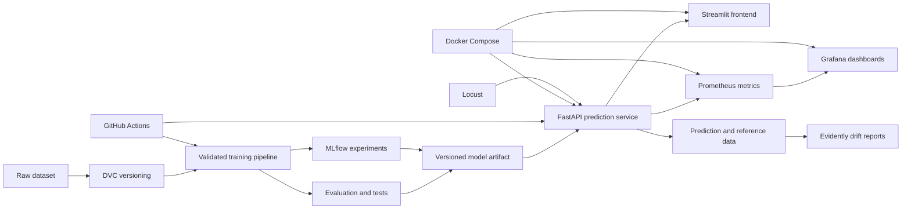

# Crop Recommendation — End-to-End MLOps

## Project Overview

This repository is the foundation for a production-oriented machine learning system that recommends a crop from soil nutrient measurements and environmental conditions. The prediction problem uses seven inputs—nitrogen, phosphorus, potassium, temperature, humidity, pH, and rainfall—to select one of 22 crop classes.

The project is being rebuilt incrementally from a small legacy prototype into a reproducible, testable, deployable, and observable MLOps portfolio project. The current repository is an early migration scaffold: it contains the raw dataset and preserved legacy reference code, but the new training pipeline and serving infrastructure have not yet been implemented.

> [!IMPORTANT]
> This is an educational decision-support project. A future prediction service should not be treated as agronomic advice without validation against representative local data and review by qualified domain experts.

## Project Objectives

The target project will demonstrate a complete machine learning lifecycle:

- reproducible data preparation, training, and evaluation;
- reliable multiclass evaluation with recorded artifacts and metrics;
- experiment tracking and data/model versioning;
- validated model serving through an API and user-facing application;
- automated tests, linting, and continuous integration and delivery;
- containerized local development and deployment;
- service, model, and data-quality monitoring; and
- drift detection and performance/load testing.

These are project objectives, not claims about the current implementation.

## Current Development Status

| Status | What exists |
| --- | --- |
| **Implemented in the new repository** | The raw dataset is stored at [`data/raw/Crop_recommendation.csv`](data/raw/Crop_recommendation.csv). It is currently the only implementation artifact outside the legacy reference directory. |
| **Legacy reference** | [`legacy/train_model.py`](legacy/train_model.py) contains a basic random-forest training script. [`legacy/app.py`](legacy/app.py) contains a Streamlit interface that loads a local pickle file. [`legacy/requirements.txt`](legacy/requirements.txt) lists their unpinned dependencies. These files have not been migrated into a production package. |
| **Planned** | A tested ML pipeline, robust evaluation, configuration, MLflow, DVC, FastAPI/Pydantic, a migrated Streamlit client, Docker, GitHub Actions, Prometheus, Grafana, Evidently, and Locust. None of these capabilities is currently implemented. |

No trained model artifact, reported model score, automated test suite, API, container configuration, CI workflow, monitoring stack, or deployment configuration is currently committed.

## Dataset Overview

The repository contains one CSV file: [`data/raw/Crop_recommendation.csv`](data/raw/Crop_recommendation.csv).

| Property | Verified value |
| --- | --- |
| Records | 2,200 |
| Input features | 7 |
| Target column | `label` |
| Target classes | 22 |
| Missing values | 0 across all columns |
| Duplicate rows | 0 |
| Class balance | 100 records per class |

### Schema

| Column | Observed type | Observed range | Meaning |
| --- | --- | ---: | --- |
| `N` | Integer | 0–140 | Nitrogen measurement |
| `P` | Integer | 5–145 | Phosphorus measurement |
| `K` | Integer | 5–205 | Potassium measurement |
| `temperature` | Numeric | 8.8257–43.6755 | Temperature; the legacy UI labels this as °C |
| `humidity` | Numeric | 14.2580–99.9819 | Relative humidity; the legacy UI labels this as percent |
| `ph` | Numeric | 3.5048–9.9351 | Soil pH |
| `rainfall` | Numeric | 20.2113–298.5601 | Rainfall; the legacy UI labels this as millimetres |
| `label` | String | 22 classes | Crop to recommend |

The CSV does not include a data dictionary, provenance, collection dates, geographic coverage, or units metadata. Units above are only stated where the legacy interface supplies them; the nutrient units remain undocumented.

### Target-Class Distribution

The dataset is exactly balanced. Each of these classes has 100 records:

`apple`, `banana`, `blackgram`, `chickpea`, `coconut`, `coffee`, `cotton`, `grapes`, `jute`, `kidneybeans`, `lentil`, `maize`, `mango`, `mothbeans`, `mungbean`, `muskmelon`, `orange`, `papaya`, `pigeonpeas`, `pomegranate`, `rice`, and `watermelon`.

## Current Repository Structure

Generated files, caches, virtual environments, and `.git/` are omitted.

```text
Crop-Recommendation-MLOps/
├── data/
│   └── raw/
│       └── Crop_recommendation.csv
├── legacy/
│   ├── app.py
│   ├── requirements.txt
│   └── train_model.py
└── README.md
```

## Current Implementation

The only executable workflow is retained under `legacy/` as migration reference.

### Training

[`legacy/train_model.py`](legacy/train_model.py):

1. Reads `Crop_recommendation.csv` from the process's current working directory.
2. Uses all columns except `label` as features and `label` as the target.
3. Creates an 80/20 train/test split with `random_state=42`.
4. Trains `sklearn.ensemble.RandomForestClassifier` with 100 trees and `random_state=42`.
5. Serializes the fitted estimator to `model.pkl` in the current working directory.

The script creates a test split but never uses it for evaluation. It does not stratify explicitly, validate the schema, record parameters or environment details, persist metrics, or package preprocessing with the model.

### Inference

[`legacy/app.py`](legacy/app.py) starts a Streamlit form with one numeric field for each of the seven features. On submission, it constructs a NumPy row in the training column order, calls `model.predict`, and displays the predicted class.

The application expects `model.pkl` in the process's current working directory. There is no API, input schema, realistic range validation, error handling, probability/confidence output, model metadata, or production deployment configuration. Because both scripts rely on relative working-directory paths, they are fragile when launched from another directory.

### Dependencies

[`legacy/requirements.txt`](legacy/requirements.txt) lists `streamlit`, `pandas`, `scikit-learn`, and `numpy`. No versions are pinned, and Python compatibility is not declared. The training script also uses Python's standard-library `pickle` module.

## Planned Architecture

### Target Architecture — Not Yet Implemented



The intended lifecycle is: version the data, validate inputs, train reproducibly, compare experiments, approve a model artifact, serve it behind a validated API, consume it from a lightweight frontend, and observe both operational behavior and data drift. CI/CD and containers will make those steps repeatable.

## Technology Stack

| Area | Current repository | Planned use |
| --- | --- | --- |
| Language and data | Python, Pandas, NumPy | Structured package, configuration, deterministic pipelines |
| Machine learning | Scikit-learn random forest in legacy code | Baselines, model comparison, reproducible evaluation, persisted pipeline |
| Testing and quality | Not implemented | pytest, Ruff, pre-commit |
| Experiment tracking | Not implemented | MLflow |
| Data/model versioning | Git tracks the CSV; no dedicated ML versioning | DVC |
| Prediction service | Not implemented | FastAPI and Pydantic |
| User interface | Legacy Streamlit script | Streamlit client integrated with the API |
| Containers | Not implemented | Docker and Docker Compose |
| CI/CD | Not implemented | GitHub Actions |
| Metrics and dashboards | Not implemented | Prometheus and Grafana |
| Data/model monitoring | Not implemented | Evidently |
| Load testing | Not implemented | Locust |

## Development Roadmap

All phases below are planned work.

### Phase 1: ML Foundation and Reliable Evaluation

- Create a maintainable Python package and configuration strategy.
- Add deterministic data loading and schema validation.
- Establish a leakage-aware, stratified evaluation workflow and baseline models.
- Report accuracy, macro precision, macro recall, macro F1, and a confusion matrix.
- Persist the selected preprocessing/model pipeline and its metadata.
- Add focused unit and integration tests for data, training, evaluation, and inference.

### Phase 2: Experiment Tracking, Versioning and Reproducibility

- Track parameters, metrics, tags, and artifacts with MLflow.
- Version dataset and model dependencies with DVC.
- Lock runtime dependencies and document reproducible commands.
- Define model promotion and artifact lineage conventions.

### Phase 3: Prediction API and Frontend Integration

- Expose health, metadata, and prediction endpoints with FastAPI.
- Validate requests and responses with Pydantic.
- Migrate the Streamlit interface to consume the API instead of loading pickle directly.
- Add API and end-to-end contract tests.

### Phase 4: Docker, Code Quality and CI/CD

- Add Ruff, pre-commit, and enforced pytest checks.
- Containerize the API and frontend and orchestrate them with Docker Compose.
- Add GitHub Actions workflows for quality, tests, builds, and controlled releases.
- Document local and CI environment parity.

### Phase 5: Monitoring, Observability and Drift Detection

- Instrument request, latency, error, and prediction metrics for Prometheus.
- Build Grafana dashboards and actionable alerts.
- Generate Evidently data-quality and drift reports against a defined reference set.
- Define logging, retention, and retraining triggers without collecting unnecessary sensitive data.

### Phase 6: Performance Testing, Final Validation and Portfolio Release

- Exercise API behavior under representative load with Locust.
- Validate failure modes, documentation, reproducibility, and container startup.
- Record final model and service results with their test conditions.
- Prepare a transparent portfolio release with architecture and operational evidence.

## Getting Started

There is no new production workflow yet. The commands below run only the preserved legacy prototype and should be treated as a local reference workflow.

### 1. Create and activate a virtual environment

```powershell
python -m venv .venv
.\.venv\Scripts\Activate.ps1
```

On macOS or Linux, activate it with `source .venv/bin/activate`.

### 2. Install the legacy dependencies

```powershell
python -m pip install -r legacy/requirements.txt
```

Because the dependency file is unpinned, a reproducible environment is not guaranteed.

### 3. Train the legacy model

The legacy scripts resolve the dataset and model relative to the current working directory. Run them from `data/raw`:

```powershell
Set-Location data/raw
python ../../legacy/train_model.py
```

This creates an untracked `data/raw/model.pkl`. Only load pickle artifacts that you trust.

### 4. Launch the legacy Streamlit app

From the same `data/raw` directory:

```powershell
streamlit run ../../legacy/app.py
```

The shell prints the local URL after startup. FastAPI, Docker Compose, MLflow, DVC, and monitoring commands will be documented only after those components exist.

## Evaluation Strategy

No evaluation results are currently available. Phase 1 will define and test the evaluation contract before reporting any model performance.

At minimum, evaluation should include:

- **accuracy** for overall multiclass correctness;
- **macro precision**, **macro recall**, and **macro F1** so every crop class contributes equally;
- a **confusion matrix** and per-class metrics to expose systematic class confusion; and
- reproducibility metadata: dataset version, code revision, split strategy and seed, parameters, dependency versions, and generated artifacts.

The current balanced dataset supports a stratified holdout baseline. Model selection and final reporting should avoid evaluating repeatedly against the final test partition; cross-validation on the training partition is preferable for comparison. Any future metric must be reported with its protocol and should not be interpreted as evidence of real-world agronomic performance.

## Future Improvements

- Establish data provenance, licensing, units, geography, and collection methodology.
- Add data contracts, range checks, semantic validation, and out-of-distribution handling.
- Compare a simple baseline with candidate classifiers using a consistent evaluation protocol.
- Make feature order and preprocessing part of one serialized inference pipeline.
- Replace direct pickle loading in the UI with a versioned, validated API contract.
- Add model metadata, calibrated probabilities where appropriate, and transparent limitations.
- Introduce experiment lineage, artifact checksums, model promotion criteria, and rollback procedures.
- Monitor data quality and drift, then define human-reviewed retraining policies.
- Evaluate the system on representative external or newly collected data before any real-world use.

## Contributing / Development Notes

Development will proceed one roadmap phase at a time. Each change should:

1. state its scope and acceptance criteria;
2. include or update tests and documentation;
3. keep generated artifacts out of source control unless deliberately versioned;
4. record reproducibility assumptions and evidence;
5. pass automated quality checks introduced by the active phase; and
6. avoid describing planned capabilities as completed work.

The `legacy/` directory is reference material. New production code should not silently modify its behavior; migration decisions should be explicit and reviewable.

## Known Limitations

- The repository currently contains no migrated ML package or end-to-end automated pipeline.
- The legacy test split is unused, so there are no verified performance metrics.
- There is no schema validation, explicit feature contract, preprocessing pipeline, or out-of-range protection.
- Dataset provenance, license, units for nutrient values, geography, time period, and sampling method are not documented in the repository.
- Perfect class balance may reflect dataset construction rather than real-world crop prevalence.
- The available data cannot establish generalization across regions, seasons, sensors, or changing climate conditions.
- Dependencies are unpinned and no supported Python version is specified.
- No `.gitignore` is present, so local environments and generated model artifacts can appear as untracked files.
- Pickle artifacts are environment-sensitive and unsafe to load from untrusted sources.
- The legacy training and app scripts depend on the caller's working directory.
- Some user-facing strings in the legacy Streamlit script contain text-encoding artifacts.
- The legacy application contains no authentication, API boundary, audit trail, confidence communication, or operational safeguards.
- Automated tests, code-quality configuration, experiment tracking, data versioning, CI/CD, containers, monitoring, drift detection, and load tests are not yet present.
- No repository license is currently included.
